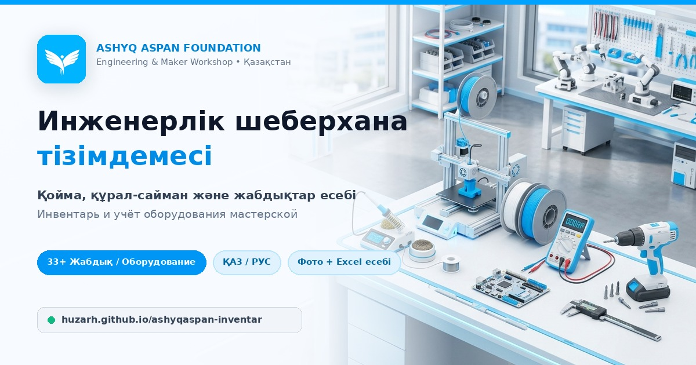

# Ashyq Aspan Foundation — Инженерлік шеберхана тізімдемесі / Инвентарь мастерской



**🌐 Live Web App (GitHub Pages):** [https://huzarh.github.io/ashyqaspan-inventar/](https://huzarh.github.io/ashyqaspan-inventar/)

Fotoğraflı malzeme kaydı, stok giriş/çıkışı, yerinde sayım, hareket geçmişi, Kazakça (ҚАЗ) / Rusça (РУС) çoklu dil desteği, Excel raporu ve tam yedek. Hem yerel ağda (SQLite ile) hem de GitHub Pages üzerinde çalışır.

## Başlatma

Önce ZIP dosyasını tamamen çıkarın. ZIP'in içinden çalıştırmayın. Python **3.8 veya daha yenisi** ve güncel Chrome, Edge, Firefox veya Safari gerekir.

**Ubuntu / Linux**

Proje klasöründe terminal açın:

```bash
python3 app.py
```

Alternatif: `bash baslat.sh`. `python3` bulunamazsa Python 3'ü sistemin paket yöneticisiyle kurun.

**Windows**

`baslat.bat` dosyasını çift tıklayın. Python yoksa Python 3'ü kurun. Kurulumda “Add Python to PATH” seçeneğini açın. Terminal alternatifi: `py -3 app.py`.

**macOS**

Terminalde proje klasörüne geçip `python3 app.py` çalıştırın. Çalıştırma izni varsa `baslat.command` dosyası da kullanılabilir.

Tarayıcı otomatik açılır. Açılmazsa **http://127.0.0.1:8765** adresine gidin. Uygulama açıkken terminal açık kalmalı. Durdurmak için terminalde **Ctrl+C** kullanın.

Port doluysa `python3 app.py --port 8766` çalıştırın ve terminaldeki yeni adresi açın. Tarayıcı açılmasını istemiyorsanız `--no-browser` ekleyin.

## İlk kayıtlar

Önceki Excel'deki **68 malzeme** ve **8 kutu/paket** ilk çalıştırmada bir kez eklenir. Kaynak olan 10 fotoğraf da projededir. Program yeniden açılınca başlangıç verisi tekrar eklenmez.

Bu miktarlar fotoğraftan çıkarılan **asgari miktarlardır**. Kesin envanter sayımı değildir. Fotoğraf bazlı bilgisayar ve mobilya eşleştirme varsayımları kayıt notlarında korunur. Grup, kutu ve takım birimleri parça adedi olarak toplanmaz. Kutu içeriği görünmüyorsa ürün olarak sayılmaz.

Bir kaydın gerçek miktarını saydığınızda **Stok → Sayım yap** ile toplam miktarı girin. Kayıt “Teyitli” olur. Stok girişi/çıkışı tek başına eski tahmini miktarı teyit etmez.

## Günlük kullanım

1. **Malzeme ekle:** Ad, kategori, miktar ve birim girin. Fotoğraf, model, konum ve not ekleyebilirsiniz. Ad ve kategori zorunludur. Art arda kayıt için “Kaydet ve devam et” kullanın.
2. **Fotoğraf:** Çekilmiş resmi seçin veya forma sürükleyin. Destekleyen mobil tarayıcılarda kamera seçeneği görünür. Fotoğraf adı veya malzeme türü otomatik tanınmaz. Tarayıcıda açılmayan HEIC fotoğrafları önce JPEG'e dönüştürün. Fotoğraflar JPEG olarak en fazla 1600 piksel uzun kenarla kaydedilir; bu uygulama orijinal fotoğraf arşivi değildir.
3. **Mevcut malzeme:** Adını yazarken benzer kayıtlar önerilir. “Stoğa ekle” seçerek yeni kart açmadan mevcut kayda geçin. Aynı ad + model + birimle birebir yinelenen kart sunucuda da engellenir. Farklı model ayrı kart olabilir.
4. **Stok ekle/çıkar:** Sadece gelen veya çıkan miktarı girin. Örneğin mevcut 4, yeni gelen 3 ise girişe 3 yazın; sonuç 7 olur. Sayım yaparken elinizdeki gerçek toplamı yazın.
5. **Konum:** “Beyaz dolap / Raf 2 / Kutu A” gibi bir konum kullanın. Arama ad, model, kategori, konum, not ve kayıt numarasında çalışır. Stok hareketlerinde işlem notu da aranır.
6. **Alt stok sınırı:** 0 uyarıyı kapatır. 0'dan büyük bir eşik girildiğinde stok bu miktara veya altına düşerse “Azalan stok” görünür. Sayım bekleyen kayıtlar da bu listede olabilir; miktarı önce teyit edin.
7. **Arşiv:** Kullanılmayan kaydı detay ekranından arşivleyin. Stok ve geçmiş silinmez. Arşivdeki kaydı geri alabilirsiniz. Birim sonradan değiştirilemez; başka birimle takibe geçecekseniz eski kaydı arşivleyip yeni bir kayıt açın.

Miktarlar **en fazla üç ondalıkla** saklanır. Adet, takım, paket, kutu, grup, metre, kg ve litre birimleri desteklenir. Farklı birimlerin miktarları yanıltıcı bir genel toplamda birleştirilmez. Yanlış stok hareketini silmek yerine açıklamalı bir ters işlem veya sayım girin.

Klavye kısayolları: `/` arama, `N` yeni malzeme. Metin yazarken veya diyalog açıkken kısayollar devreye girmez.

## Excel ve yedek

- **Excel indir:** Tüm aktif ve arşivlenmiş kayıtlar raporlanır. Üç sekme bulunur: Malzemeler, Kutu Kontrolü, Stok Hareketleri. Mevcut ekran filtresi Excel'i kısıtlamaz. Fotoğraflar Excel'e gömülmez; dosya adları ve kaynak referansları bulunur. Dosya gerçek `.xlsx` biçimindedir.
- **Yedekle:** Kayıtları, stok geçmişini ve sizin eklediğiniz fotoğrafları birlikte içeren bir `.json` tam yedek indirir. Düzenli olarak başka bir diske kopyalayın. İlk kaynak fotoğrafları proje içinde ayrıca saklanır.
- **Yedeği yükle:** Bu uygulamanın JSON yedeğini seçin. İçerik doğrulanır ve mevcut envanterin tamamının yerine geçer; birleştirme yapmaz. İşlem öncesi veritabanının otomatik kopyası `data/otomatik_yedekler/` altına kaydedilir. Önceki fotoğraflar diskte tutulur. Geçersiz yedek veritabanını değiştirmez. En fazla 120 MB JSON yedek desteklenir.
- Excel'i düzenlemek uygulamadaki veriyi değiştirmez. Excel içe aktarma yoktur. Başka bilgisayara geçirmek için projeyi kopyalayın ve JSON yedeğini geri yükleyin. Kaynak fotoğraf klasörünü de koruyun.

## Verilerin yeri

```text
atolye-envanter/
  app.py                     Uygulama sunucusu
  seed.json                  Bir kez aktarılan başlangıç listesi
  static/                    Arayüz ve başlangıç fotoğrafları
  data/                      İlk çalıştırmada oluşturulur
    envanter.sqlite3         Asıl veritabanı
    uploads/                 Yeni eklediğiniz fotoğraflar
    otomatik_yedekler/       Geri yükleme öncesi veritabanı kopyaları
  tests/                     Testler
```

Uygulamayı kapatıp klasörü taşımak kayıtları kaybettirmez. `data` klasörünü silmeyin. Güncelleme yaparken eski `data` klasörünü koruyun. Tam klasör kopyası alacaksanız önce uygulamayı kapatın; çalışırken yedek almak için arayüzdeki “Yedekle” düğmesini kullanın. SQLite'ın `-wal` ve `-shm` dosyalarını uygulama çalışırken elle silmeyin.

İsterseniz başka veri dizini belirleyebilirsiniz:

```bash
python3 app.py --data-dir /tam/yol/atolye-verileri
```

## Kapsam

Uygulama yalnızca **127.0.0.1** üzerinde dinler. Hesap, bulut aboneliği, API anahtarı, Supabase veya internet gerekmez. Aynı bilgisayarda birkaç sekme açılabilir; eşzamanlı güncellemeler eski sürüm kontrolü ve veritabanı işlemleriyle korunur. Telefondan aynı ağ üzerinden erişim ve ekip üyeleri için kullanıcı yetkilendirme bu sürümde bulunmaz. Fotoğrafları bilgisayara aktararak yükleyebilirsiniz.

Bu yerel sürümü port yönlendirme veya ters proxy ile internete açmayın; çok kullanıcılı erişim için kimlik doğrulama ve ayrı dağıtım gerekir. Yerel kayıt istekleri istek anahtarı ve kaynak denetimiyle korunur. Kayıtlar ve fotoğraflar şifrelenmeden kendi diskinizde saklanır.

## Doğrulama

```bash
python3 -m unittest discover -s tests -v
```

Testler geçici dizinlerde çalışır; kendi `data` klasörünü değiştirmez. Başlangıç aktarımı, kalıcı kayıt, yinelenen kayıtlar, eşzamanlı stok, negatif stok engeli, tekrar gönderim, fotoğraf, Excel, tam yedek/geri yükleme ve HTTP API erişim kontrollerini kapsar.

Geliştiriciler için isteğe bağlı arayüz mantık testi: `node tests/test_ui.js`. Bu ek test için Node.js gerekir; uygulamanın normal çalışması için gerekmez. Otomatik testler gerçek tarayıcıda görsel ve kamera doğrulamasının yerini almaz.

`prepare_seed.py` önceki Excel'i başlangıç verisine dönüştürmek için kullanılan araçtır. Normal kullanımda çalıştırılmaz. `seed.json` dosyasını değiştirmek mevcut kayıtları otomatik güncellemez.
